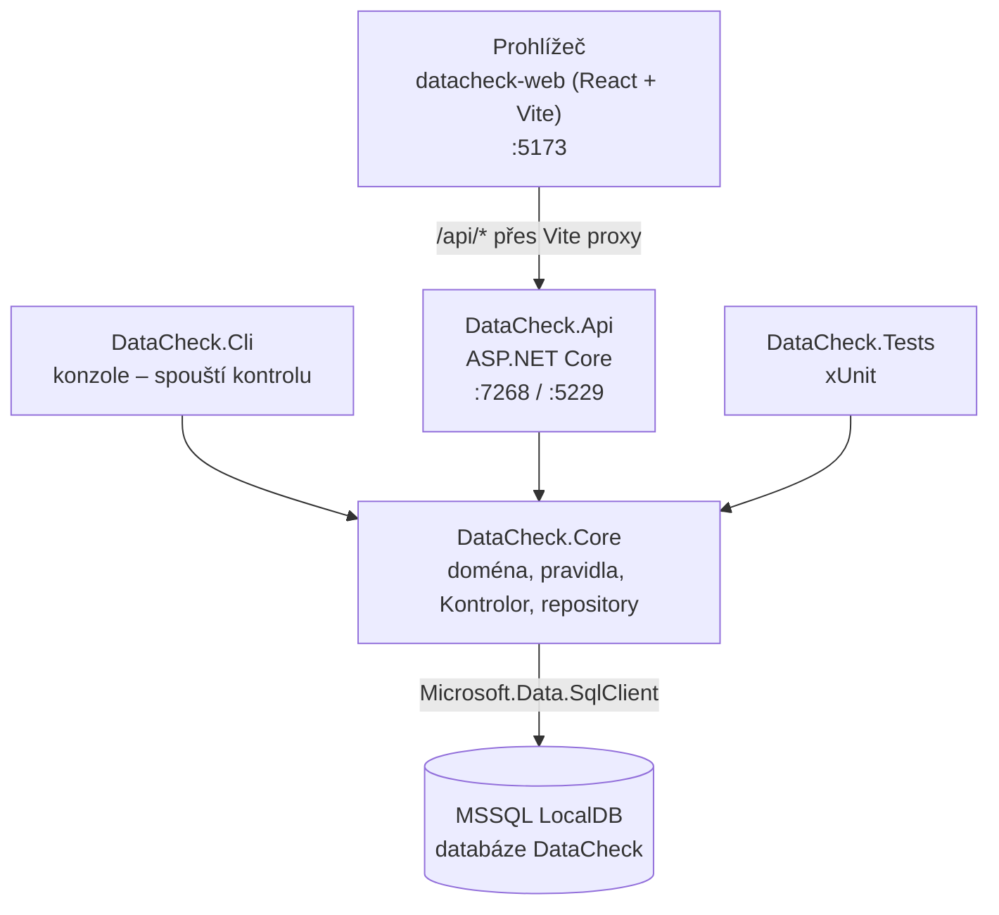
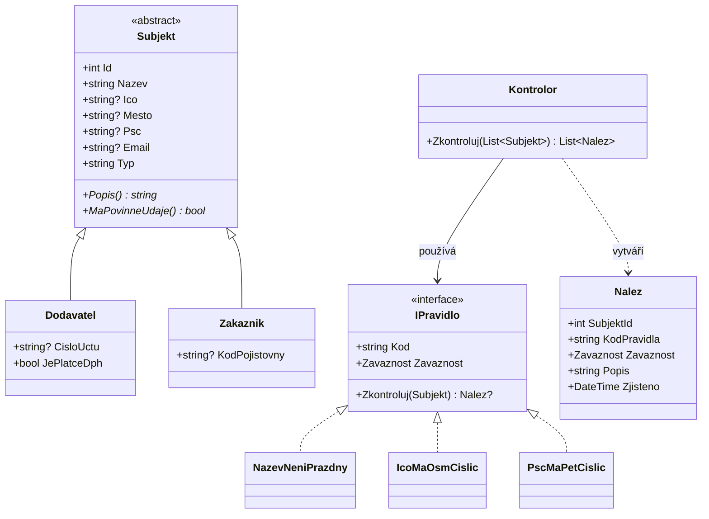
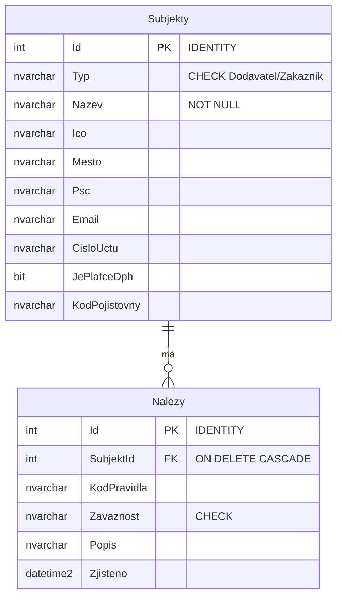
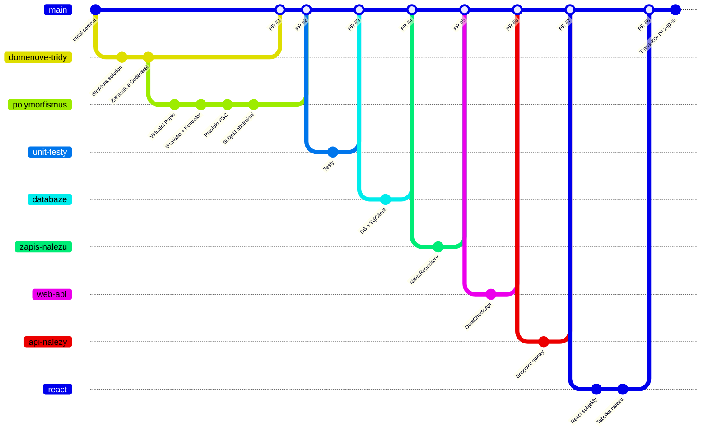

# DataCheck

Nástroj pro kontrolu kvality kmenových dat (dodavatelé, zákazníci). Načte subjekty z databáze, projede je sadou kontrolních pravidel a výsledné nálezy uloží a zobrazí ve webovém rozhraní.

Vznikl jako adaptační projekt (junior vývojář, Dentimed, září–říjen 2026) pro nácvik OOP v C#/.NET, MSSQL, React, unit testů a práce s Gitem. Doménově vychází z reálného problému: nekonzistentní data v adresáři a u dodavatelů.

---

## Co aplikace dělá

1. Načte subjekty (dodavatele a zákazníky) z tabulky `Subjekty`
2. Každý subjekt projde všemi aktivními kontrolními pravidly
3. Každé porušení pravidla zaznamená jako **nález** se závažností `Chyba`, `Varovani` nebo `Informace`
4. Nálezy uloží do tabulky `Nalezy`. Každý běh kontroly **nahradí** výsledky předchozího (v jedné transakci)
5. Webové rozhraní zobrazí nálezy (barevně podle závažnosti) a seznam subjektů

### Kontrolní pravidla

| Kód | Třída | Závažnost | Co kontroluje |
|---|---|---|---|
| `NAZEV_PRAZDNY` | `NazevNeniPrazdny` | Chyba | Název subjektu není prázdný ani jen z mezer |
| `ICO_DELKA` | `IcoMaOsmCislic` | Chyba | Vyplněné IČO má přesně 8 znaků a jen číslice |
| `PSC_FORMAT` | `PscMaPetCislic` | Varování | Vyplněné PSČ má 5 číslic (mezera `570 01` je povolena) |

Prázdné IČO ani prázdné PSČ pravidla záměrně neřeší. Každé pravidlo kontroluje právě jednu věc.

---

## Architektura



| Projekt | Typ | Účel |
|---|---|---|
| `DataCheck.Core` | knihovna tříd | Veškerá logika: doménové třídy, pravidla, `Kontrolor`, přístup k databázi |
| `DataCheck.Cli` | konzolová aplikace | Spustí kontrolu nad databází a zapíše nálezy |
| `DataCheck.Api` | ASP.NET Core Web API | Zpřístupní subjekty a nálezy jako JSON |
| `DataCheck.Tests` | xUnit | Unit testy pravidel, doménových tříd a `Kontrolor` |
| `datacheck-web` | React (Vite) | Webové rozhraní |

Core nezná žádný ze svých konzumentů. Konzole, API i testy jsou jen různé vstupy do stejné logiky.

### Doménový model



Klíčová rozhodnutí:

- **`Subjekt` je abstraktní třída**, protože dodavatel i zákazník *jsou* subjekty a sdílejí data. Samostatný „obecný subjekt" vytvořit nelze.
- **`IPravidlo` je interface**, protože pravidla nemají společná data, jen stejnou schopnost. Nové pravidlo = nová třída, `Kontrolor` se nemění (Open/Closed).
- **`Kontrolor` dostává pravidla v konstruktoru** (dependency injection). Díky tomu jde v testech podstrčit falešné pravidlo.
- **IČO, PSČ a podobné identifikátory jsou `string`**, ne číslo, aby se neztratily úvodní nuly (`00023001`).

### Databáze



Jedna tabulka pro oba typy subjektů (*table-per-hierarchy*) se sloupcem `Typ`. Indexy na `Subjekty.Ico` a `Nalezy.SubjektId`.

---

## Požadavky

- **.NET 10 SDK** a **Visual Studio 2026** (VS 2022 .NET 10 nepodporuje)
- **SQL Server LocalDB** (`(localdb)\MSSQLLocalDB`), instaluje se s Visual Studiem
- **SSMS** (volitelně, pro práci s databází)
- **Node.js LTS** (vyzkoušeno 24.x) s npm

---

## Spuštění od nuly

### 1. Databáze

V SSMS se připoj na `(localdb)\MSSQLLocalDB` a spusť v tomto pořadí:

1. `sql/01_vytvoreni_tabulek.sql` – vytvoří databázi `DataCheck`, tabulky, omezení a indexy
2. `sql/02_testovaci_data.sql` – testovací data (20 subjektů s nastraženými chybami). Lze spustit opakovaně, vždy začne od čistých tabulek.

`sql/03_dotazy.sql` obsahuje ukázkové dotazy (počty, vadná IČO, duplicitní IČO, nálezy se subjekty).

### 2. Kontrola dat (konzole)

Otevři `DataCheck.slnx` ve Visual Studiu 2026, nastav **DataCheck.Cli** jako spouštěný projekt a spusť (Ctrl+F5).

Nebo z terminálu v kořeni repozitáře:

```bash
dotnet run --project DataCheck.Cli
```

### 3. API

Nastav **DataCheck.Api** jako spouštěný projekt a spusť (Ctrl+F5), nebo:

```bash
dotnet run --project DataCheck.Api --launch-profile https
```

| Endpoint | Popis |
|---|---|
| `GET /api/subjekty` | Všechny subjekty včetně `typ` |
| `GET /api/nalezy` | Nálezy z poslední kontroly, závažnost jako text |

### 4. Web

API musí běžet. Pak:

```bash
cd datacheck-web
npm install
npm run dev
```

a otevři `http://localhost:5173`. Vite přeposílá `/api/*` na `https://localhost:7268` (viz `vite.config.js`).

### 5. Testy

```bash
dotnet test
```

---

## Struktura repozitáře

```
datacheck/
├── DataCheck.Core/
│   ├── Subjekt.cs, Dodavatel.cs, Zakaznik.cs
│   ├── Nalez.cs, IPravidlo.cs, Kontrolor.cs
│   ├── SubjektRepository.cs, NalezRepository.cs, DbNastaveni.cs
│   └── Pravidla/
│       ├── NazevNeniPrazdny.cs
│       ├── IcoMaOsmCislic.cs
│       └── PscMaPetCislic.cs
├── DataCheck.Cli/          Program.cs
├── DataCheck.Api/          Controllers/SubjektyController.cs, NalezyController.cs
├── DataCheck.Tests/        testy pravidel, Subjekt, Kontrolor
├── datacheck-web/          React (src/App.jsx, vite.config.js)
├── sql/                    01 tabulky, 02 testovací data, 03 ukázkové dotazy
└── DataCheck.slnx
```

---

## Historie vývoje

Každá část vznikla ve vlastní větvi a do `main` se dostala přes pull request.



---

## Známá omezení a další kroky

- **Connection string je v kódu** (`DbNastaveni.cs`). Patří do `appsettings.json` / konfigurace prostředí.
- **Historie kontrol se neuchovává**, každý běh přepíše předchozí nálezy. Další krok: tabulka `Behy` a vazba nálezu na běh.
- **API nevrací Id nálezu**, React proto používá index jako `key`.
- **Pravidla jsou zapnutá natvrdo v kódu.** Plán: konfigurace v JSON (zapnutí, závažnost).
- **Chybí pravidla nad celou kolekcí**, např. duplicitní IČO. V testovacích datech má `Dentimed s.r.o.` a `Dentimed Tábor` stejné IČO a aplikace to zatím neodhalí. Vyžaduje druhý typ rozhraní (pravidlo nad sadou subjektů).
- **Dodavatel bez IČO** se při načtení z DB vytvoří s IČO „neuvedeno" (konstruktor ho vyžaduje).
- **Plánováno:** import z XML exportu POHODY (pozor na kódování Windows-1250), export nálezů do Excelu.
